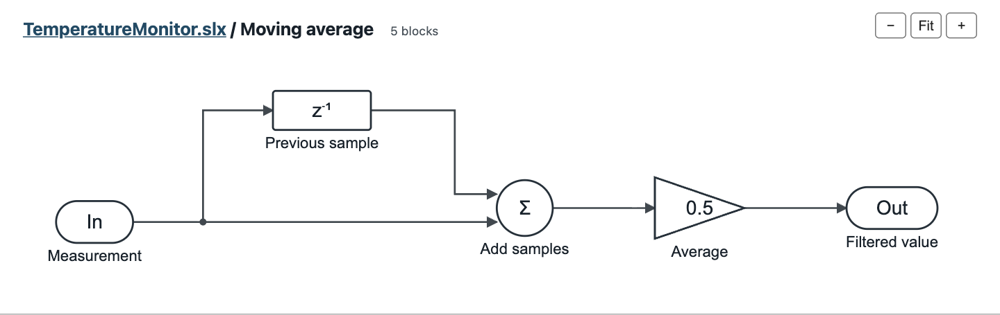

# Simulink Diagram Viewer

Open an `.slx` file in VS Code, or select it in Finder and press Space. Both extensions display the saved block layout and signal branches. VS Code lets you open nested blocks, follow the breadcrumb back, and zoom. Finder shows each subsystem below the top-level diagram.



The moving average combines the current temperature reading with the previous sample. Click the model name above the diagram to return to the top level.

## Install the VS Code extension

Download [slx-viewer.vsix from the latest release](https://github.com/SuwonLee-KMU/slx-viewer/releases/latest/download/slx-viewer.vsix). In VS Code, open Extensions, select the **…** menu, and choose **Install from VSIX**. Open an SLX model and click a subsystem to inspect its diagram.

## Build and install locally

Use Node.js 22 or later. The macOS build requires Xcode and XcodeGen.

```sh
npm ci
npm test
npm run package
code --install-extension dist/slx-viewer.vsix
bash scripts/macos.sh install
```

If another VS Code extension is selected, use **Reopen Editor With… → Simulink Diagram Viewer**. If macOS asks to enable the preview extension, select **SLX Preview** in System Settings under Quick Look extensions.

## Model support

The viewer reads split system XML and older inline systems in SLX files. Common block types have simple icons. Other blocks display their type and name. The viewer reads the diagram without starting MATLAB or executing model callbacks, masks, or block code. Custom mask artwork, Stateflow state charts, external model contents, legacy MDL files and simulation are outside the supported feature set. Port locations are estimated from block bounds, orientation and port counts. Layout can differ from Simulink, particularly for special ports, rich annotations and custom masks.

The archive limit is 64 MiB and the diagram XML limit is 24 MiB. On macOS the app is signed for local use. The app imports the MathWorks SLX type and does not claim the default editor role.
